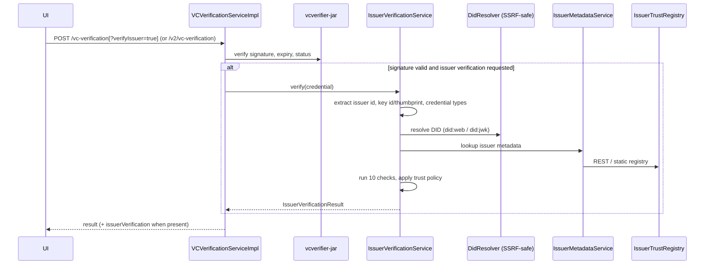
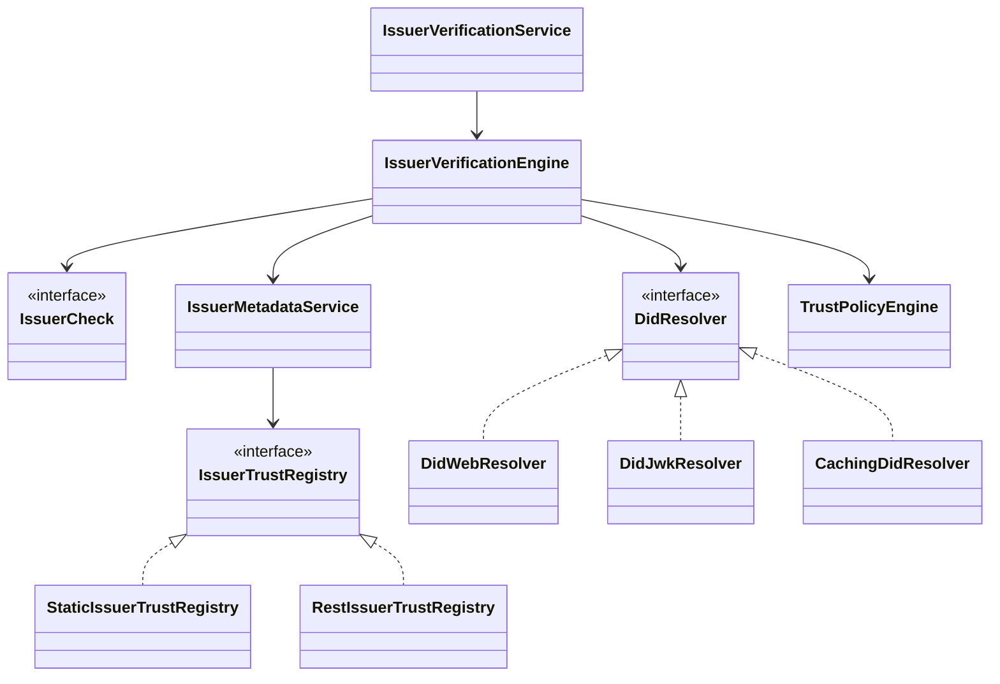

# Issuer Details Verification

See also: [`CHANGES.md`](CHANGES.md) (what changed), [`QA-HANDOVER.md`](QA-HANDOVER.md) (test guide), and the Postman collection and environment in this folder.

Adds an optional, additive issuer check to both `POST /vc-verification` (legacy) and `POST /v2/vc-verification` (this branch is based on tag `v0.17.0`). It answers two independent questions and reports them separately:

1. **Cryptographic authenticity** – was the credential signed by a key controlled by the issuer identifier?
2. **Organizational trust** – is that issuer registered, active, accredited and authorised for this credential type?

Infrastructure failures (timeouts, registry down) yield `INCONCLUSIVE`, never `UNTRUSTED`. Issuer metadata embedded in the credential is never trusted; metadata comes only from a configured registry.

Status: **disabled by default**. With `inji.verify.issuer-verification.enabled=false` no beans are created and the endpoint behaves exactly as before.

## 1. Existing architecture (as found)

- `verify-service` (Spring Boot 3.4.10, Java 21 at `v0.17.0`) delegates signature verification to `vcverifier-jar` 1.7.0 (`CredentialsVerifier`). The legacy `VCVerificationServiceImpl.verify(vc, contentType)` picks the format from the `Content-Type` header (LDP, SD-JWT via `application/vc+sd-jwt` / `application/dc+sd-jwt`, CWT via `application/vc+cwt`), checks revocation status and returns `VCVerificationStatusDto{verificationStatus}`. `verifyV2` returns the detailed `VCVerificationResultDto` and is also used internally by the VP-submission flow.
- The library returns pass/fail only. It does not expose which key verified, and for `did:web` it fetches with library-default HTTP (no SSRF guard in our code, timeouts not configurable by us). For SD-JWT with `x5c` it does not (as far as we could determine) bind the certificate chain to an issuer identity. Verify against the library version in use before relying on this statement.
- No issuer trust registry or issuer-authorisation concept existed. The SDK (`@injistack/react-inji-verify-sdk`) calls the legacy `/vc-verification` and passes the result to the UI (it does not call `/v2` at this tag).

Consequence: a valid signature alone proves only that *someone* holding that key signed it.

## 2. Flow

Issuer verification runs only after the signature is valid, so forged input cannot trigger outbound requests.

## 3. Components (`io.inji.verify.issuer`)

| Package | Role |
|---|---|
| `extract` | Reads issuer id, signing key reference and credential types from the credential (JSON-LD, JWT/SD-JWT incl. `x5c`). |
| `did` | `DidResolver` for `did:web`, `did:jwk`; `CachingDidResolver` (successes only). |
| `net` | `SafeHttpFetcher` (GET and POST) + `UrlSafetyPolicy`: https only, public IPs only (checked after DNS), port rules, optional host allowlist, no redirects, size/time limits. |
| `crypto` | JWK parsing/validation, RFC 7638 thumbprints, Base58. |
| `registry` | `IssuerTrustRegistry` abstraction; `StaticIssuerTrustRegistry`, `RestIssuerTrustRegistry`, `TrqpIssuerTrustRegistry`; strict metadata parser. |
| `metadata` | `IssuerMetadataService` (canonical `IssuerMetadata`, TTL cache, staleness protection). |
| `engine` | 10 independent `IssuerCheck`s and `IssuerVerificationEngine`. |
| `policy` | `TrustPolicy`, `TrustPolicyEngine` (fail-closed). |
| `config` | `IssuerVerificationProperties`, `IssuerVerificationConfig` (conditional on `enabled=true`). |

### Class overview

## 4. Checks and policies

Checks (display order): `ISSUER_IDENTIFIER_VALID`, `DID_RESOLUTION`, `DID_DOCUMENT_VALID`, `PUBLIC_KEY_VALID`, `SIGNATURE_KEY_AUTHORIZED` (cryptographic); `ISSUER_REGISTERED`, `ISSUER_ACTIVE`, `ACCREDITATION_VALID`, `CREDENTIAL_TYPE_AUTHORIZED`, `TRUST_FRAMEWORK_VALID` (organizational).
Each check is `PASS`, `FAIL`, `INCONCLUSIVE`, `NOT_EVALUATED` or `NOT_APPLICABLE`.

| Policy | Required | Use |
|---|---|---|
| A | all cryptographic + registered, active, accredited, type authorised | strict registry |
| B | cryptographic only; registry advisory | DID-only deployments |
| C | A-style plus approved trust framework | federated trust |
| D | cryptographic + registered + authorised for the credential type | TRQP registries (no accreditation data) |
| custom | declared under `policies.<name>` | enterprise |

Rules: `ISSUER_IDENTIFIER_VALID` and `SIGNATURE_KEY_AUTHORIZED` are always required. Any `FAIL` on a required check → `UNTRUSTED`; required check `INCONCLUSIVE` → `INCONCLUSIVE`; a registry-reported suspended/revoked/deactivated issuer is always `UNTRUSTED`, even if the check is only optional.

## 5. API contract

**Legacy:** `POST /vc-verification[?verifyIssuer=true|false]` – body and `Content-Type` unchanged (raw credential). `verifyIssuer` omitted → server `run-by-default` applies. Ignored if the feature is disabled.

Response: `{"verificationStatus": "SUCCESS|INVALID|EXPIRED|REVOKED", "issuerVerification": {...}}`.

**v2:** `POST /v2/vc-verification` with JSON `{"verifiableCredential": "...", "verifyIssuer": true|false}` (`verifyIssuer` optional, same semantics; existing fields `skipStatusChecks`, `statusCheckFilters`, `includeClaims` unchanged). Response is the existing `VCVerificationResultDto` plus the optional `issuerVerification`.

`issuerVerification` is omitted when issuer verification did not run. Fields follow the Java records in `issuer/model/IssuerVerificationResult`; main fields: `issuerId`, `issuerName`, `legalName`, `organizationType`, `jurisdiction`, `overallStatus` (`TRUSTED|UNTRUSTED|INCONCLUSIVE`), `displayStatus`, `policy`, `cryptographicAuthenticity`, `organizationalTrust`, `checks[{id,status,reasonCode,message}]`, `accreditation`, `trustRegistry`, `verifiedAt`, `failureReasons`.

It runs only when the signature is valid (legacy: `SUCCESS` or `EXPIRED`; v2: `schemaAndSignatureCheck.valid`). With `enforce=true`: legacy `SUCCESS` with a non-`TRUSTED` issuer becomes `INVALID` (`EXPIRED`/`REVOKED` unchanged); v2 `allChecksSuccessful` becomes `false`. Default is `false` (advisory).

**Credential formats:** the extractor reads LDP and JWT/SD-JWT credentials. CWT credentials return `INCONCLUSIVE` / `UNSUPPORTED_CREDENTIAL_FORMAT`; this is reported, never silently treated as trusted.

**VP submission flow:** `VerifiablePresentationSubmissionServiceImpl` calls `verifyV2` without `verifyIssuer`, so when the feature is enabled the server default applies to credentials inside presentations too, and with `enforce=true` an untrusted issuer lowers that credential's `allChecksSuccessful`. The `issuerVerification` block itself is not added to the VP result DTOs (`CredentialResultsDto` is unchanged). Set `run-by-default=false` to keep VP results untouched.

## 7. Database impact
None.

## 8. UI / SDK
- SDK: `verifyIssuer` prop on `QRCodeVerification`, `issuerVerification` added to the `onVCProcessed` result only when present. `vcVerification` still returns just the status string; the new `vcVerificationDetailed` returns both. CWT/SD-JWT content-type selection and non-200 error handling are unchanged.
- `verify-ui`: `IssuerVerificationSection` (status badge, issuer details, expandable checks) rendered on the result page only when the response contains `issuerVerification`. Strings are in `en.json` under `IssuerVerification` (other locales fall back to the default language).
- The UI only receives the block if the SDK version it uses includes the passthrough; `verify-ui` depends on the published npm package (`@injistack/react-inji-verify-sdk`), so it needs the new SDK release. With an older SDK the section simply does not render. The UI does not pass `verifyIssuer` to the SDK (the published typings do not have it); the server default decides.

## 9. Changes to existing files
| File | Change |
|---|---|
| `VCVerificationController` | optional `verifyIssuer` query parameter on the legacy endpoint (absent → original 2-argument service path) |
| `VCVerificationStatusDto` | optional `issuerVerification` (`NON_NULL`); explicit ctors replace `@AllArgsConstructor` |
| `VCVerificationService` | new overload `verify(vc, contentType, Boolean verifyIssuer)` |
| `VCVerificationRequestDto` | optional `verifyIssuer`; explicit ctors replace `@AllArgsConstructor` (the 1-arg ctor used by the VP flow is kept) |
| `VCVerificationResultDto` | optional `issuerVerification` (`NON_NULL`); explicit 5-arg ctor replaces `@AllArgsConstructor` |
| `VCVerificationServiceImpl` | optional field-injected `IssuerVerificationService`; step in `verify` and `verifyV2` |
| `application.properties` | new keys |
| SDK `QRCodeVerification.{tsx,types.ts}`, `utils/api.ts` | `verifyIssuer` prop, `vcVerificationDetailed`, `issuerVerification` on the result object |
| `verify-ui` `Result/index.tsx`, `QrScanner.tsx`, `Upload.tsx`, `data-types.ts`, `en.json` | render the section; widen handler types |

## 10. Limitations and not-yet-verified
- **Verified on this branch (Maven, Java 21, Spring Boot 3.4.10):** `mvn test` in `verify-service` passes with 0 failures and 0 errors, including all pre-existing tests, the `issuer` package tests, `VCVerificationServiceImplIssuerTest`, `VCVerificationControllerIssuerTest` and `IssuerVerificationWiringTest` (real Spring context; real engine with an offline `did:jwk` issuer and a static registry; enforce mode; startup failure on a bad registry type).
- **Not verified:** nothing was run against a live service with Postgres, a real signed credential, a public `did:web` host, or a running Affinidi registry. `vcverifier-jar` is mocked in the issuer tests, so the interaction of real signature verification (LDP, SD-JWT, CWT) with the new step is untested. The Postman collection has not been executed against this build.
- **SDK:** type-checks and builds (`npm run build`) after `npm install --no-package-lock`. The repository's `package-lock.json` is already out of sync with `package.json` on `v0.17.0` (`npm ci` fails on `@injistack/pixelpass`), and the one existing Jest suite (`OpenID4VPVerification.spec.tsx`) fails to parse under that install, with and without this change. No SDK test covers the new code.
- **verify-ui:** the new `IssuerVerificationSection` spec passes. Three existing Result specs (`index`, `VcCardDisplay`, `ResultSummary`) and some `tsc` errors in existing files fail identically on the untouched `v0.17.0` tree (`window._env_` undefined in the test environment), so they are not a regression signal. The `Result/index.tsx` wiring itself is therefore not covered by an automated test.
- Supported issuer ids: `did:web`, `did:jwk`, https issuers via registry. `did:key`, `did:ion` etc. are not implemented. Anything else → `INCONCLUSIVE`.
- Static registry loads at start-up only.
- SD-JWT `x5c` chain validation is not performed; only key binding to the registry thumbprint where configured.
- Registry responses are not signed; authenticity relies on TLS and the operator's choice of registry.
