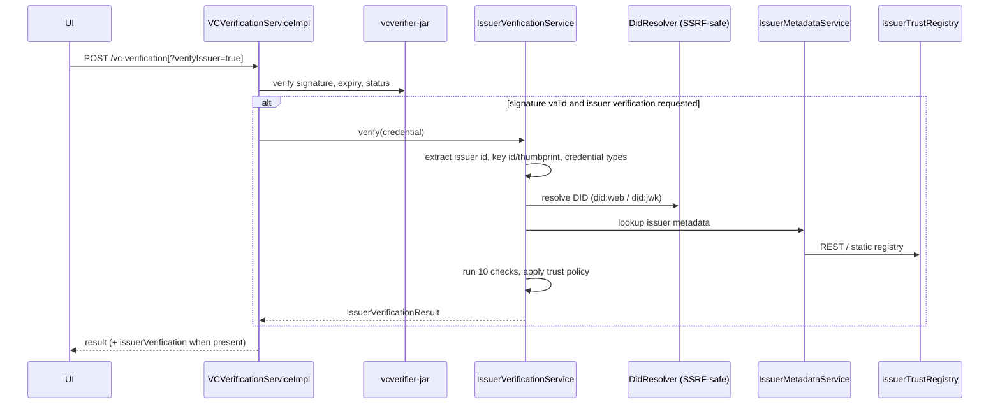
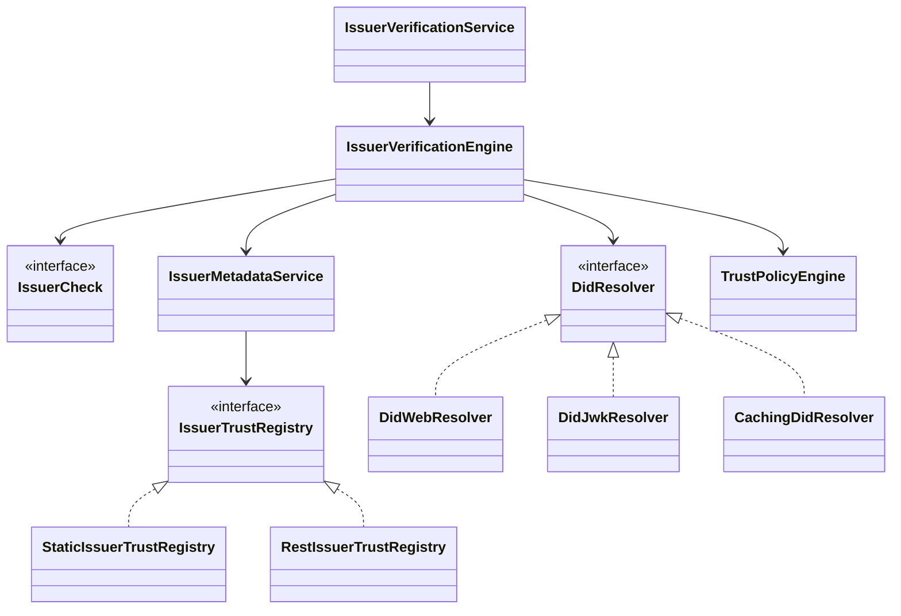

# Issuer Details Verification

Adds an optional, additive issuer check to `POST /vc-verification` (this branch is based on tag `v0.14.0`, which has no `/v2/vc-verification`). It answers two independent questions and reports them separately:

1. **Cryptographic authenticity** – was the credential signed by a key controlled by the issuer identifier?
2. **Organizational trust** – is that issuer registered, active, accredited and authorised for this credential type?

Infrastructure failures (timeouts, registry down) yield `INCONCLUSIVE`, never `UNTRUSTED`. Issuer metadata embedded in the credential is never trusted; metadata comes only from a configured registry.

Status: **disabled by default**. With `inji.verify.issuer-verification.enabled=false` no beans are created and the endpoint behaves exactly as before.

## 1. Existing architecture (as found)

- `verify-service` (Spring Boot 3.2.3, Java 21 at `v0.14.0`) delegates signature verification to `vcverifier-jar` 1.3.0 (`CredentialsVerifier`). `VCVerificationServiceImpl.verify` handles LDP VCs only and returns `VCVerificationStatusDto{verificationStatus}`.
- The library returns pass/fail only. It does not expose which key verified, and for `did:web` it fetches with library-default HTTP (no SSRF guard in our code, timeouts not configurable by us). For SD-JWT with `x5c` it does not (as far as we could determine) bind the certificate chain to an issuer identity. Verify against the library version in use before relying on this statement.
- No issuer trust registry or issuer-authorisation concept existed. The SDK (`@injistack/react-inji-verify-sdk`) calls `/vc-verification` and passes the response to the UI.

Consequence: a valid signature alone proves only that *someone* holding that key signed it.

## 2. Flow

Issuer verification runs only after the signature is valid, so forged input cannot trigger outbound requests.

## 3. Components (`io.inji.verify.issuer`)

| Package | Role |
|---|---|
| `extract` | Reads issuer id, signing key reference and credential types from the credential (JSON-LD, JWT/SD-JWT incl. `x5c`). |
| `did` | `DidResolver` for `did:web`, `did:jwk`; `CachingDidResolver` (successes only). |
| `net` | `SafeHttpFetcher` + `UrlSafetyPolicy`: https only, public IPs only (checked after DNS), port rules, optional host allowlist, no redirects, size/time limits. |
| `crypto` | JWK parsing/validation, RFC 7638 thumbprints, Base58. |
| `registry` | `IssuerTrustRegistry` abstraction; `StaticIssuerTrustRegistry`, `RestIssuerTrustRegistry`; strict metadata parser. |
| `metadata` | `IssuerMetadataService` (canonical `IssuerMetadata`, TTL cache, staleness protection). |
| `engine` | 10 independent `IssuerCheck`s and `IssuerVerificationEngine`. |
| `policy` | `TrustPolicy`, `TrustPolicyEngine` (fail-closed). |
| `config` | `IssuerVerificationProperties`, `IssuerVerificationConfig` (conditional on `enabled=true`). |

### Class overview

## 4. Checks and policies

Checks (display order): `ISSUER_IDENTIFIER_VALID`, `DID_RESOLUTION`, `DID_DOCUMENT_VALID`, `PUBLIC_KEY_VALID`, `SIGNATURE_KEY_AUTHORIZED` (cryptographic); `ISSUER_REGISTERED`, `ISSUER_ACTIVE`, `ACCREDITATION_VALID`, `CREDENTIAL_TYPE_AUTHORIZED`, `TRUST_FRAMEWORK_VALID` (organizational).
Each check is `PASS`, `FAIL`, `INCONCLUSIVE`, `NOT_EVALUATED` or `NOT_APPLICABLE`.

| Policy | Required | Use |
|---|---|---|
| A | all cryptographic + registered, active, accredited, type authorised | strict registry |
| B | cryptographic only; registry advisory | DID-only deployments |
| C | A-style plus approved trust framework | federated trust |
| custom | declared under `policies.<name>` | enterprise |

Rules: `ISSUER_IDENTIFIER_VALID` and `SIGNATURE_KEY_AUTHORIZED` are always required. Any `FAIL` on a required check → `UNTRUSTED`; required check `INCONCLUSIVE` → `INCONCLUSIVE`; a registry-reported suspended/revoked/deactivated issuer is always `UNTRUSTED`, even if the check is only optional.

## 5. API contract

`POST /vc-verification[?verifyIssuer=true|false]` – body unchanged (raw VC string). `verifyIssuer` omitted → server `run-by-default` applies. Ignored if the feature is disabled.

Response: `{"verificationStatus": "SUCCESS|INVALID|EXPIRED", "issuerVerification": {...}}`. `issuerVerification` is omitted when issuer verification did not run. Fields follow the Java records in `issuer/model/IssuerVerificationResult`; main fields: `issuerId`, `issuerName`, `legalName`, `organizationType`, `jurisdiction`, `overallStatus` (`TRUSTED|UNTRUSTED|INCONCLUSIVE`), `displayStatus`, `policy`, `cryptographicAuthenticity`, `organizationalTrust`, `checks[{id,status,reasonCode,message}]`, `accreditation`, `trustRegistry`, `verifiedAt`, `failureReasons`.

It runs only when the signature is valid (`SUCCESS` or `EXPIRED`). With `enforce=true`, a `SUCCESS` credential whose issuer is not `TRUSTED` is reported as `INVALID`; `EXPIRED` is left unchanged. Default is `false`.

> Review item: `trustRegistry.registryId` is currently serialised. If registry identity should not reach end users, strip it from the DTO. The UI does not display it. No OpenAPI file was updated.

### REST registry contract
`GET {rest-base-url}/issuers/{url-encoded issuerId}` → 200 with the canonical record (see `sample-static-registry.json`), 404 if unknown, other statuses/timeouts → `INCONCLUSIVE`. Optional bearer token. Outage results are never cached.

## 6. Configuration

All keys under `inji.verify.issuer-verification.` with env overrides in `application.properties`: `enabled`, `run-by-default`, `enforce`, `active-policy`, `approved-trust-frameworks`, `clock-skew`, `did.{allowed-hosts,allow-private-hosts,connect-timeout,read-timeout,cache-ttl}`, `registry.{type,id,static-file,rest-base-url,rest-bearer-token,allow-private-hosts,connect-timeout,read-timeout,cache-ttl,not-found-cache-ttl,max-metadata-age}`. `registry.type`: `none`, `static`, `rest`. Invalid policy/registry configuration fails start-up.

## 7. Database impact
None.

## 8. UI / SDK
- SDK: `verifyIssuer` prop on `QRCodeVerification`, `issuerVerification` added to the `onVCProcessed` result only when present. `vcVerification` still returns just the status string.
- `verify-ui`: `IssuerVerificationSection` (status badge, issuer details, expandable checks) rendered on the result page only when the response contains `issuerVerification`. Strings are in `en.json` under `IssuerVerification` (other locales fall back to the default language).
- The UI only receives the block if the SDK version it uses includes the passthrough; the UI depends on the published npm package, so it needs the new SDK release.

## 9. Changes to existing files
| File | Change |
|---|---|
| `VCVerificationController` | optional `verifyIssuer` query parameter |
| `VCVerificationStatusDto` | optional `issuerVerification` (`NON_NULL`); explicit ctors replace `@AllArgsConstructor` |
| `VCVerificationService` | new overload `verify(vc, Boolean verifyIssuer)` |
| `VCVerificationServiceImpl` | optional field-injected `IssuerVerificationService`; step in `verify` |
| `application.properties` | new keys |
| SDK `QRCodeVerification.{tsx,types.ts}`, `utils/api.ts` | `verifyIssuer` prop, `vcVerificationDetailed`, `issuerVerification` on the result object | |
| `verify-ui` `Result/index.tsx`, `data-types.ts`, `en.json` | as above |

## 10. Limitations and not-yet-verified
- **Not built with Maven** (Maven Central unreachable in the authoring environment). The `issuer` package was compiled with `javac` and tested (104 tests) against a small JUnit shim; Spring/Lombok/Mockito-dependent code was only checked against stubs. `VCVerificationServiceImplIssuerTest`, `VCVerificationControllerIssuerTest` and `IssuerVerificationConfigTest` need a real `mvn test`. Existing repo tests were not re-run after the DTO changes.
- SDK was not type-checked or built (no dependencies installed). `verify-ui`: jest on the Result folder passes; `tsc` reports one error in an existing spec I did not touch.
- Supported issuer ids: `did:web`, `did:jwk`, https issuers via registry. `did:key`, `did:ion` etc. are not implemented. Anything else → `INCONCLUSIVE`.
- Static registry loads at start-up only.
- SD-JWT `x5c` chain validation is not performed; only key binding to the registry thumbprint where configured.
- Registry responses are not signed; authenticity relies on TLS and the operator's choice of registry.
